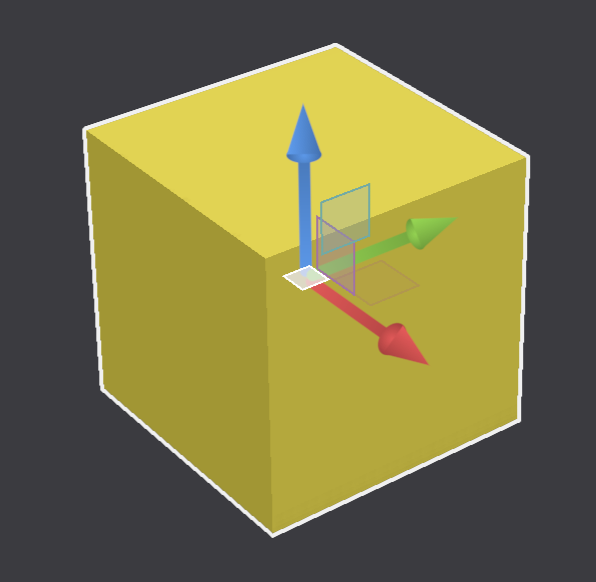

# viewport-lib-gizmo

A move / rotate / scale transform gizmo for [viewport-lib](https://github.com/grimandgreedy/viewport-lib) scenes. It hit-tests the handles, turns drags and G / R / S keyboard sessions into transforms, and builds overlay items for your renderer, with no wgpu dependency.

<p align="center">
  
</p>

## Examples

- **gizmo_basic**: one cube with the default style.
- **gizmo_styling**: a sidebar that edits the `GizmoStyle` live.
- **gizmo_multi_viewport**: one gizmo shared across four views, three of them orthographic.

```sh
cargo run --example gizmo_basic
cargo run --example gizmo_styling
cargo run --example gizmo_multi_viewport
```
